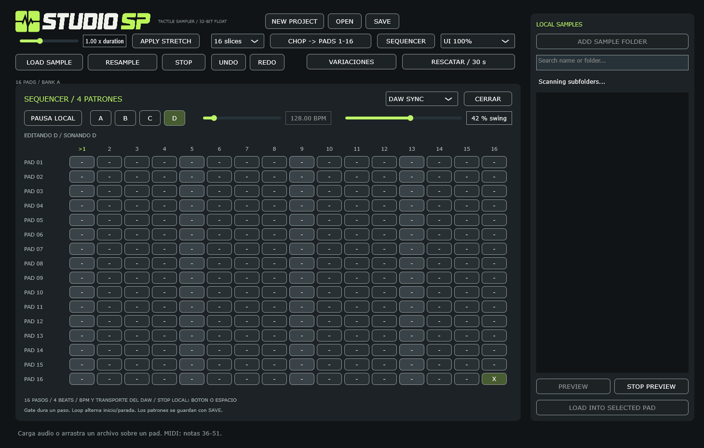

# StudioSP

Sampler en C++20 / JUCE 8 basado en [SPECIFICATION.md](SPECIFICATION.md).



## Implementado

- Secuenciador de cuatro patrones A/B/C/D: 16 pasos por cada uno de los 16 pads, BPM interno (40-240) y swing (0-75 %). DAW SYNC sigue tempo, Play/Stop y posicion del host, incluidos saltos y loops. Cambio de patron al siguiente ciclo, indicador de paso y persistencia en proyectos/estado del plugin.
- Interfaz oscura de 16 pads, estados de reproducción y forma de onda.
- Ventana redimensionable con escala proporcional (50-200 %). Al abrir se ajusta al area util de la pantalla principal; conserva el diseno completo, incluidos buscador y controles inferiores.
- Dentro de un DAW abre como maximo al 70 % (1022x651 antes del escalado del host). El selector UI permite elegir 50-200 % directamente; tambien refleja los cambios hechos al redimensionar la ventana. Si el DAW conserva un tamano anterior o aplica zoom adicional, usa UI 60 % o UI 50 %.
- VARIACIONES por pad: cuatro alternativas con intensidad y opciones independientes de pitch, recorte, fades y 12-bit. Comparacion con el original, preescucha y guardado en otro pad con Undo. El pad fuente se conserva.
- RESCATAR / 30 s: recupera hasta los ultimos 30 segundos de salida de StudioSP con efectos y proteccion de picos, excluyendo la preescucha. Fija el final al pulsar el boton y copia en un worker independiente de cargas/conversiones. Permite escuchar, recortar IN/OUT y guardar solo el fragmento elegido. Usa un pad vacio por defecto; reemplazar otro pide confirmacion.
- WAV, FLAC y AIFF mediante drag/drop o LOAD SAMPLE; almacenamiento float, hasta 192 kHz y 5 minutos por sample.
- Teclado, ratón y MIDI con velocidad. Notas MIDI 36–51 corresponden a pads 1–16; eventos alineados dentro del bloque.
- REC MIDI graba por capas en el patron que suena, con velocidad, duracion y cuantizacion 1/16 opcional. EXPORT MIDI guarda el patron elegido como .mid con tempo y timing/swing, sin audio ni efectos.
- One Shot, Gate, Loop (segundo disparo detiene el loop), ocho grupos de choke.
- STOP, choke, retrigger y toggle de Loop usan transiciones de 3 ms con una voz principal y una cola preasignada por pad. Retriggers rapidos conservan continuidad al reemplazar la cola. STOP tambien suaviza el corte de efectos; la preescucha mantiene su parada inmediata.
- Pitch ±24 semitonos con Sinc Blackman de 32 puntos y cutoff adaptado al ratio. Conversión entre frecuencia de archivo y host; mono duplicado a estéreo.
- Volumen, panorama, recorte y fades de entrada/salida por pad (0–100 ms). El recorte define también el loop. Gate usa el fade de salida al soltar la tecla.
- Forma de onda con picos min/max precalculados, zoom con rueda o +/−, FIT, SELECTION y marcadores IN/OUT arrastrables. Shift+rueda o Alt+arrastrar desplaza la vista.
- Filtro paso bajo, drive y delay global de 375 ms con feedback.
- Resampleo interno estéreo a float antes de la protección de salida, buffer preasignado de 60 segundos.
- Grabación de entrada de interfaz: canal 1 o 2 mono, o 1+2 estéreo, hasta 60 segundos al pad seleccionado. Captura seca sin efectos ni monitorización por altavoces, con medidor de entrada y Undo.
- Buscador local: añade varias carpetas, indexa WAV/FLAC/AIFF en subcarpetas en segundo plano y filtra por nombre o ruta. PREVIEW escucha el resultado sin ocupar pads ni entrar en las capturas; STOP PREVIEW lo detiene. Doble clic o LOAD INTO SELECTED PAD carga el resultado. Recuerda las carpetas al abrir el programa de nuevo.
- Modo opcional por pad de 12 bits lineales a 26,04 kHz: remuestreo con filtro antes de reducir la frecuencia y cuantización a 4096 niveles. Conserva el audio original; desactivar el modo o UNDO lo recupera. Se guarda en los proyectos. Es una emulación digital de esas especificaciones, no una reproducción de toda la electrónica de un sampler físico.
- Time-stretch offline Rubber Band 3.3.0, motor R3: duracion de 0,5x a 2x conservando pitch, original y Undo. Procesamiento en segundo plano; salida limitada a cinco minutos. El modo clasico se aplica despues del stretch.
- Chop de la region IN/OUT en 4, 8 o 16 partes iguales, con marcas en la onda. Reemplaza pads 1-N y se deshace/rehace como una sola operacion; comparte los buffers de audio.
- Undo/Redo de carga, borrado, resampleo y ajustes por pad (recorte, fades, volumen, pitch, pan, modo y choke). Cada gesto arrastrado es una operación. Los efectos globales todavía no tienen historial.
- El historial conserva como maximo 128 operaciones entre Undo/Redo y un presupuesto estimado de 256 MiB de audio adicional. Al superar un limite descarta operaciones antiguas completas. Cuenta una sola vez los buffers compartidos e incluye originales, stretch, modo clasico y picos de onda; el audio de los pads actuales no cuenta como memoria adicional del historial. La liberacion ocurre en el hilo de reclamacion y no interrumpe voces activas. No es un limite de RAM total: pads actuales, voces, capturas, trabajos en curso y liberaciones pendientes usan memoria aparte.
- El callback reproduce snapshots inmutables sin tomar bloqueos de edición. Cargar, editar, borrar y deshacer no modifica voces que ya estén sonando; el próximo disparo usa la nueva versión.
- Carga/guardado de proyectos, carga de samples y finalización del resampleo en segundo plano. Se comparten buffers entre historial y snapshots; su liberación ocurre fuera del hilo de audio.
- Reclamacion de snapshots e historial retirado en un hilo propio, independiente del editor. Las colas de transicion tambien mantienen sus snapshots protegidos.
- Proyectos `.studiosp` y estado del plugin con audio incorporado.
- Standalone y VST3 en Windows/Linux; también AU en macOS.

## Instalador para Windows

El asistente permite elegir Standalone, VST3 y acceso en el escritorio; incluye desinstalador y Visual C++ Runtime x64 cuando hace falta. Requiere Windows 10/11 de 64 bits y permisos de administrador. Cierra StudioSP y tus DAW antes de instalar. La desinstalacion conserva proyectos, samples y preferencias.

Para generar el .exe: `./scripts/build-installer.ps1`. La salida queda en `build/dist/StudioSP-0.3.0-Setup-x64.exe`, junto con su SHA-256. El instalador se puede usar sin Internet y no necesita Python, Visual Studio ni CMake en el equipo de destino. Para validar el empaquetado: `./scripts/test-installer.ps1`. Instrucciones y limites de la prueba aislada en [installer/README.md](installer/README.md). El instalador todavia no tiene firma digital.

## Compilar

Windows: Visual Studio / Build Tools con **Desarrollo para el escritorio con C++**, Windows SDK, Git y CMake 3.22+. JUCE 8.0.4 y Rubber Band 3.3.0 se descargan en la primera configuración.

```powershell
./scripts/build.ps1
```

El script configura, compila y ejecuta las pruebas. Con CMake disponible en PATH, en cualquier sistema:

```sh
cmake -S . -B build -DCMAKE_BUILD_TYPE=Release
cmake --build build --config Release --parallel 2
ctest --test-dir build -C Release --output-on-failure
```

Para usar JUCE local: añade `-DJUCE_SOURCE_DIR=/ruta/a/JUCE` al configurar. Linux requiere además las dependencias nativas de JUCE para audio, X11 y fuentes. AU requiere macOS.

Para Rubber Band local, añade `-DRUBBERBAND_SOURCE_DIR=/ruta/a/rubberband` (checkout 3.3.0). Se compila su unidad `single/RubberBandSingle.cpp`, con FFT/remuestreo incluidos. Rubber Band se ofrece bajo GPL-2.0 o posterior, o licencia comercial: revisa `COPYING` de esa dependencia y las condiciones de JUCE antes de distribuir.

Windows genera `build/StudioSP_artefacts/Release/Standalone/StudioSP.exe` y `build/StudioSP_artefacts/Release/VST3/StudioSP.vst3`. Otros generadores pueden omitir la carpeta `Release`.

## Uso

Pulsa **SEQUENCER** para abrir la rejilla. Selecciona A/B/C/D y activa los pasos de cada pad (X = activo). Cada patron dura un compas 4/4; cada columna es una semicorchea. Ajusta **BPM** y **SWING**, y pulsa **PLAY**. El swing retrasa las semicorcheas pares manteniendo la duracion de cada pareja; 0 % es recto. Durante PLAY puedes editar y elegir otro patron: se edita inmediatamente y empieza a sonar al siguiente compas. **STOP PATTERN**, STOP principal o Espacio detienen la reproduccion; PLAY vuelve al paso 1 del patron elegido. Cerrar el panel permite seguir tocando los pads mientras el patron suena.

En **DAW SYNC** sigue el BPM, Play/Stop y posicion de la cancion del DAW. Las nuevas instancias VST3/AU usan este modo; standalone usa **INTERNAL**. El BPM manual queda desactivado en DAW y muestra el valor recibido; el swing sigue disponible. Los saltos y loops se realinean con la rejilla del host. Si faltan BPM/posicion, muestra un aviso y espera en silencio. **PAUSA LOCAL**, STOP o Espacio pausan el seguimiento; **SEGUIR DAW** lo reactiva. El transporte del DAW puede parar y reanudar sin desarmarlo. Para tocar sin DAW, selecciona INTERNAL y PLAY. Los patrones conservan ciclos de cuatro negras alineados a PPQ 0 aunque cambies el compas del DAW. Esta sincronizacion afecta al secuenciador; el time-stretch, los loops de audio y el delay global conservan sus ajustes propios.

Los pasos nuevos dibujados a mano usan velocidad maxima; los grabados conservan la velocidad MIDI. One Shot reproduce el sample, Gate usa la duracion grabada (o un paso en los manuales) y Loop alterna inicio/parada en cada golpe. SAVE guarda los cuatro patrones, timing, velocidades, duraciones, cuantizacion, BPM interno, swing y reloj elegido. Al restaurar INTERNAL queda detenido; DAW SYNC espera el transporte del host. REC MIDI nunca se restaura armado. Los proyectos antiguos conservan INTERNAL y sus pasos originales. NEW PROJECT vacia patrones y restaura INTERNAL, 120 BPM / 0 % swing. No incluye Undo de pasos.

Para **grabar MIDI**, conecta tu controlador y activa su entrada MIDI en AUDIO / MIDI (standalone) o enruta MIDI al plugin en tu DAW. Carga sonidos en los pads, abre SEQUENCER, pulsa **REC MIDI** y arranca PLAY o el transporte del DAW. Toca las notas 36-51: se anaden al patron que suena, sin borrar los pasos anteriores. Si hay un cambio A/B/C/D pendiente, sigue grabando en el patron actual hasta que cambie. **Quantize 1/16** acerca el golpe a la semicorchea mas cercana con swing; desactivado conserva el timing a resolucion de 9600 ticks por negra y no lo desplaza al cambiar swing despues. Cada casilla admite un golpe por pad: volver a tocar esa casilla lo reemplaza. La escucha es inmediata; el golpe nuevo no vuelve a dispararse en ese mismo ciclo. **STOP MIDI REC** termina el overdub; STOP local, cambiar reloj, cargar o crear proyecto nuevo tambien lo desarman. Con el DAW parado REC queda a la espera y no captura notas. Tambien puedes grabar tocando los pads con raton o las teclas del ordenador; esos golpes se capturan al inicio del siguiente bloque de audio. La preescucha del buscador y el propio patron no se graban de nuevo.

Para **exportar**, elige A/B/C/D y pulsa **EXPORT MIDI**, indica un nombre .mid y guarda. Exporta un ciclo de cuatro negras, notas 36-51 en canal 10, velocidades, duraciones y timing/swing, mas tempo actual y compas 4/4. En DAW SYNC usa el ultimo BPM valido recibido; en INTERNAL usa el BPM manual. Los note-off se cierran como maximo al final del ciclo. Puedes importar el archivo en el piano roll del DAW; los sonidos y efectos de StudioSP no van incluidos. No requiere que el patron este sonando.

1. Configura salida, entrada de audio y MIDI en AUDIO / MIDI (Standalone). Activa los canales de tu interfaz que quieres grabar. En un DAW, usa su ruteo de audio y MIDI.
2. Arrastra un sample sobre un pad. Pulsarlo selecciona y reproduce; LOAD SAMPLE carga al seleccionado.
3. Usa las teclas según la tabla. Espacio detiene voces y limpia el delay.
4. Arrastra IN/OUT sobre la onda para recortar. Rueda o +/− hace zoom; Shift+rueda o Alt+arrastrar desplaza. FIT muestra todo; SELECTION ajusta al recorte. Las barras permiten introducir porcentajes. Ajusta FADE IN/OUT en milisegundos para suavizar los extremos (por defecto 2/3 ms en samples nuevos).
5. RESAMPLE → pad de destino → toca otros pads → FINISH REC. Seleccionar destino inicia captura sin dispararlo. STOP también guarda la captura y al llegar a 60 s se guarda automáticamente. UNDO recupera el sample anterior.
6. SAVE / OPEN guardan/restauran el proyecto con samples en segundo plano. Ctrl+Z / Ctrl+Shift+Z deshace/rehace samples y ajustes por pad. Las ediciones se aplican al siguiente disparo; una voz activa conserva su versión hasta terminar o recibir STOP/choke. Al abrir un proyecto se detiene la reproducción anterior.
7. NEW PROJECT permite empezar de cero. Pide confirmacion antes de vaciar los 16 pads, restaurar los efectos y borrar Undo/Redo. Cancela la grabacion y la preescucha; espera a los trabajos de archivo anteriores para que sus resultados no reaparezcan despues del reinicio. Para conservar tu trabajo, cancela y usa SAVE primero. Los archivos guardados, las carpetas de samples y la configuracion de audio/MIDI se conservan.
8. Selecciona un pad con sample y pulsa VARIACIONES. Marca los parametros que quieres cambiar y ajusta la intensidad; GENERAR 4 crea V1-V4. Pulsa ORIGINAL o una alternativa para escucharla. Ajusta IN/OUT si hace falta, elige destino y GUARDAR EN PAD. El pad original no aparece entre los destinos. Cerrar descarta los borradores; las alternativas aceptadas se guardan como pads normales en el proyecto.
9. Toca libremente y pulsa RESCATAR / 30 s, sin armar una grabacion previa. ESCUCHAR permite revisar el audio; arrastra IN/OUT o usa las barras y guarda el fragmento en un pad. Si todos estan ocupados tendras que elegir uno y confirmar el reemplazo. UNDO recupera su contenido anterior. La captura incluye solo StudioSP: no los otros instrumentos ni los efectos del Mixer de FL Studio. El fragmento guardado vuelve a pasar por los efectos actuales cuando lo disparas como cualquier pad.

El rescate avanza mientras el host procesa audio; con Smart Disable o procesamiento detenido depende de los bloques que el DAW entregue. Es temporal: cambiar de dispositivo/frecuencia, abrir otro proyecto o NEW PROJECT limpia el buffer. El anillo usa aproximadamente 12 MiB a 48 kHz y 47 MiB a 192 kHz, ademas de la copia rescatada y los borradores, fuera del presupuesto de Undo. Se reserva un margen de dos segundos para copiar sin detener el audio; si la copia queda obsoleta, se rechaza y puedes intentar rescatar de nuevo. Los borradores y el buffer sin guardar no se incluyen en los archivos de proyecto.

| Fila visual | Teclas | Pads |
|---|---|---|
| Superior | 1 2 3 4 | 13–16 |
| Segunda | Q W E R | 9–12 |
| Tercera | A S D F | 5–8 |
| Inferior | Z X C V | 1–4 |

Los pads empiezan vacíos; no incluye kit de samples. El teclado requiere foco en el editor y los campos de texto capturan teclas mientras se editan.

Para grabar tu interfaz, selecciona un pad, elige INPUT 1 / MONO, INPUT 2 / MONO o INPUT 1 + 2 / STEREO y pulsa REC INPUT. STOP REC (o STOP) finaliza la grabación y reemplaza el sample de ese pad; UNDO lo recupera. La entrada se graba seca y no se escucha por la salida del programa: usa la monitorización directa de tu interfaz. Los números indican el primer y segundo canal activados en AUDIO / MIDI. RESAMPLE sigue grabando solo la mezcla interna de pads. El máximo es 60 segundos por captura.

En LOCAL SAMPLES, pulsa ADD SAMPLE FOLDER para añadir una carpeta. Incluye subcarpetas; puedes añadir varias. El recorrido omite enlaces de directorio y junctions para evitar ciclos. Cerrar el editor cancela su escaneo sin esperar a la lectura del disco. Escribe en el buscador, selecciona un resultado y pulsa PREVIEW para escucharlo; STOP PREVIEW o STOP lo detiene. La preescucha usa un nivel fijo de 0,65 y sale directamente sin efectos de pads ni ganancia master; no entra en RESAMPLE ni en la grabación de interfaz. Para cargarlo, selecciona el pad de destino y haz doble clic en un resultado o pulsa LOAD INTO SELECTED PAD. La carga mantiene los límites de 192 kHz y cinco minutos por archivo.

Las carpetas se guardan en `StudioSP/sample-folders.json` dentro de la carpeta de datos del usuario (AppData en Windows), compartida por standalone y plugin. Se vuelven a escanear al abrir el editor. Las rutas de discos desconectados se conservan para que vuelvan a aparecer al conectar el disco y abrir el editor de nuevo.

Con un sample cargado, activa **12 BIT / 26.04 kHz** en su panel para usar el modo clásico. La conversión se realiza en segundo plano y se aplica en el próximo disparo del pad. Los nuevos archivos y grabaciones empiezan con el modo desactivado. Los recortes se muestran sobre el original; el modo clásico conserva su duración con una tolerancia de una muestra a 26,04 kHz. Los datos siguen almacenados en float: el sonido clásico utiliza un buffer con valores cuantizados de 12 bits, no un archivo empaquetado de 12 bits. Los proyectos antiguos mantienen el modo desactivado.

Para time-stretch, ajusta el control `x duration` y pulsa **APPLY STRETCH**: 2x duplica la duracion y 0,5x la reduce a la mitad. Trabaja siempre desde el original, conservando el pitch; el control PITCH sigue cambiando velocidad y duracion durante reproduccion. Aplicar 1x restaura la duracion original. UNDO/REDO recupera ambos buffers y el modo clasico. Las ediciones realizadas mientras se procesa invalidan el resultado, para evitar sobrescribir cambios nuevos. Los proyectos guardan el original y el ratio; al abrirlos se reconstruye el buffer procesado, lo que puede aumentar el tiempo de carga. Las versiones anteriores de StudioSP no conocen el ratio y reproduciran el original.

Para chop, ajusta IN/OUT, elige **4/8/16 slices** y revisa las marcas en la onda original. **CHOP -> PADS 1-N** reemplaza esos destinos con partes iguales de la seleccion; un solo UNDO restaura todos. Tambien funciona cuando el origen esta entre los destinos. Conserva stretch, modo clasico y parametros del origen, pero los cortes usan One Shot. La onda representa el original; la duracion de la etiqueta incluye el stretch. No hay deteccion automatica de transitorios ni cortes manuales independientes.

## Diferencias con la especificación

Esta es una primera versión funcional del flujo básico; no un motor audiófilo terminado.

- La salida usa un clipper a −0.1 dBFS de picos de muestras; **no un limitador true-peak** ni una certificación BS.1770 / −0.1 dBTP.
- Pendientes: time-stretch en vivo/sincronizado al tempo del host, CLAP, multiples bancos, chop por transitorios o cortes manuales y buses FX independientes. `FxBusTarget` permanece como metadato; los efectos actuales son globales.
- Sinc de ventana finita reduce aliasing, no garantiza su ausencia. Pitch cambia la duración. Drive no está sobremuestreado.
- Resampleo evita D/A y conserva float; los efectos y la conversión de frecuencia transforman la señal. Float no significa headroom infinito ni aritmética sin pérdidas.
- El callback usa una cola SPSC y referencias protegidas a snapshots; no usa el mutex de edición ni libera samples. Bajo publicación continua un disparo puede descartarse tras cuatro intentos para mantener acotado el callback. Esto no certifica ausencia de cortes por sobrecarga de CPU/dispositivo.
- Finalizar una captura espera la confirmación del próximo bloque de audio antes de copiarla en segundo plano. Si el host está detenido, la captura permanece pendiente hasta que vuelva a procesar. Cambiar el dispositivo/frecuencia cancela la captura pendiente.
- Los fades reducen discontinuidades en recortes y note-off Gate. Las transiciones de STOP/choke/retrigger duran 3 ms y pueden alterar ligeramente ataques o colas; no garantizan ausencia perceptual de artefactos en cualquier audio. Fin natural sin fade, Gate con fade de 0 ms y STOP PREVIEW conservan cortes inmediatos. Los archivos antiguos sin fades conservan 0 ms al restaurarlos.
- El callback no ejecuta Rubber Band. Cargar estado desde un host sigue siendo sincrono y puede tardar al reconstruir stretch/clasico; el host debe llamar a la restauracion fuera de `processBlock`. La cancelacion de stretch/clasico es cooperativa. Lecturas de disco y restauracion de proyectos todavia pueden demorar el cierre del editor.
- No hay automatizacion de parametros DAW. La sincronizacion del secuenciador requiere BPM y PPQ validos del host (1-1000 BPM); no modifica la duracion de los samples.
- La latencia depende de dispositivo/host; no se garantiza <2.5 ms.

## Código y pruebas

`src/PluginProcessor.h` contiene el procesador y estado; `src/audio/AudioEngine.h` contiene MIDI, mezcla, efectos, captura e historial. `PadSampler.h` implementa voces y `dsp/SincInterpolator.h` la reconstrucción. `src/ui/MainComponent.*` contiene editor y pads.

`tests/DspTests.cpp` comprueba DSP, MIDI, choke, resampleo, historial y proyectos, ademas de reproduccion con el mutex ocupado, publicacion/reclamacion/guardado concurrentes, buffers compartidos con copia al editar, fades, zoom y limites de marcadores. Incluye continuidad de STOP/choke/retrigger, robo de colas, bloques variables y cero, reconfiguracion, auditoria de `new/delete` del callback, duracion/pitch/estereo del stretch, cancelacion, resultados obsoletos, samples cortos, estado antiguo y Undo/Redo conjunto de chop. La auditoria no intercepta todas las variantes de asignacion ni llamadas directas a malloc/free. Renderiza el editor en `build/StudioSP-editor.png` para inspeccion visual. No certifica calidad perceptual, latencia, true-peak ni estabilidad en todos los hosts.
