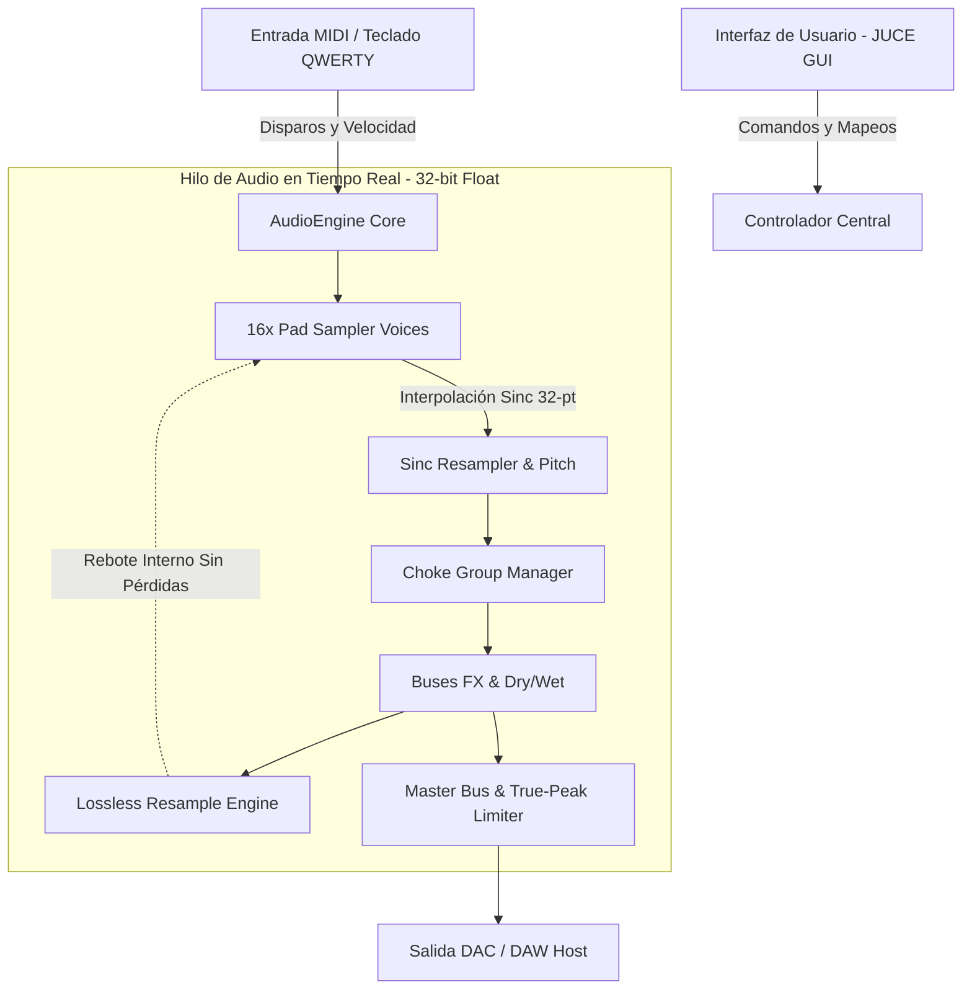

# StudioSP: Especificación Técnica y Arquitectura de Software

**StudioSP** es un sampler de software híbrido (Standalone y plugin VST3/AU/CLAP) que traslada la inmediatez y el workflow legendario de la familia **Roland SP** al entorno informático moderno con un **motor de audio de precisión audiófila**.

---

## 1. Arquitectura del Sistema



---

## 2. Diferenciadores Clave de Calidad de Audio (Hi-Fi)

| Área | Samplers SP Clásicos | StudioSP |
| :--- | :--- | :--- |
| **Pila de Procesamiento** | 16-bit / 32-44.1 kHz enteros | **32-bit Floating Point** (cero truncamiento ni distorsión por acumulación) |
| **Pitch Shifting** | Interpolación lineal con aliasing | **32-point Windowed Sinc** (agudos cristalinos sin armónicos parásitos) |
| **Resampling** | Pérdida de calidad con cada rebote | **Captura en memoria a 32-bit float** con historial *Undo/Redo* infinito |
| **Time-Stretching** | Granular metálico y robótico | Integración de **Rubber Band v3** (transitorios nítidos y coherencia de fase) |
| **Salida Master** | Saturación analógica fija o clipping | **Limitador True-Peak** calibrated a -0.1 dBTP (evita distorsión inter-sample) |

---

## 3. Estructura de Directorios del Código Fuente

El proyecto ha sido inicializado en tu espacio de trabajo local:
`C:\Users\mauri\.gemini\antigravity\scratch\studiosp\`

```text
studiosp/
├── CMakeLists.txt                 # Compilación multiplataforma con JUCE 8
├── README.md                      # Documentación completa del proyecto
├── src/
│   ├── main.cpp                   # Punto de entrada de la aplicación Standalone
│   ├── audio/
│   │   ├── AudioEngine.h          # Coordinador de buses, pads y resampleo
│   │   ├── PadSampler.h           # Voz de reproducción por cada Pad
│   │   └── dsp/
│   │       └── SincInterpolator.h # Motor matemático Sinc para Pitch sin aliasing
│   ├── model/
│   │   └── PadData.h              # Estructura del sample, puntos Loop y Chop
│   └── ui/                        # Componentes gráficos de la interfaz
```

---

## 4. Flujo de Trabajo en Pantalla (UX)

* **Disparo Inmediato:** Mapeo automático de los 16 pads al teclado de tu laptop:
  * Banco 4: `Z`, `X`, `C`, `V` (Pads 1 al 4)
  * Banco 3: `A`, `S`, `D`, `F` (Pads 5 al 8)
  * Banco 2: `Q`, `W`, `E`, `R` (Pads 9 al 12)
  * Banco 1: `1`, `2`, `3`, `4` (Pads 13 al 16)
* **Arrastrar y Soltar:** Carga directa de archivos `.wav`, `.flac` y `.aiff` en cualquier resolución (hasta 192 kHz / 32-bit float) sobre el pad.
* **Resample en Vivo:** Presionas `RESAMPLE`, seleccionas el pad de destino, tocas tu patrón en los pads y el resultado se captura sin pasar por ninguna conversión D/A degradante.
